# Manual do usuário — Renovador de Livros 2.0

O Renovador de Livros acompanha os empréstimos da sua conta na Biblioteca da UFTM (sistema Sophia) e renova os livros antes do vencimento, dentro das regras da biblioteca. Tudo fica no seu dispositivo: o app só conversa com a biblioteca.

> As telas deste manual usam dados fictícios.

## Sumário

1. [Instalação](#1-instalação)
2. [Primeiro uso](#2-primeiro-uso)
3. [Painel](#3-painel)
4. [Empréstimos](#4-empréstimos)
5. [Agenda](#5-agenda)
6. [Histórico e estatísticas](#6-histórico-e-estatísticas)
7. [Contas](#7-contas)
8. [Ajustes](#8-ajustes)
9. [Notificações e segundo plano](#9-notificações-e-segundo-plano)
10. [Problemas comuns](#10-problemas-comuns)
11. [Privacidade e limites de uso](#11-privacidade-e-limites-de-uso)

## 1. Instalação

Baixe o instalador na página oficial de versões do projeto. Use só essa fonte.

**Windows 10 ou 11**
- Use o arquivo `…_x64-setup.exe` (recomendado) ou o `…_x64_pt-BR.msi`. A instalação é só para o seu usuário e não pede senha de administrador.
- O instalador ainda não tem assinatura digital. Se o Windows mostrar "O Windows protegeu o computador", clique em **Mais informações › Executar assim mesmo**.

**Linux**
- `AppImage`: dê permissão de execução (`chmod +x`) e abra.
- `.deb` (Ubuntu, Debian, Mint) ou `.rpm` (Fedora, openSUSE): instale pelo gerenciador de pacotes.

**Android 8 ou mais recente**
- Baixe o arquivo `.apk` no celular e abra. Se o Android pedir, permita instalar apps dessa origem.
- No primeiro uso, permita as notificações (seção 9).

**macOS**
- Use o `.dmg`. Como o app ainda não tem assinatura da Apple, na primeira vez abra **Ajustes do Sistema › Privacidade e Segurança** e clique em **Abrir mesmo assim**.

## 2. Primeiro uso

Na primeira abertura, o app mostra 5 etapas.

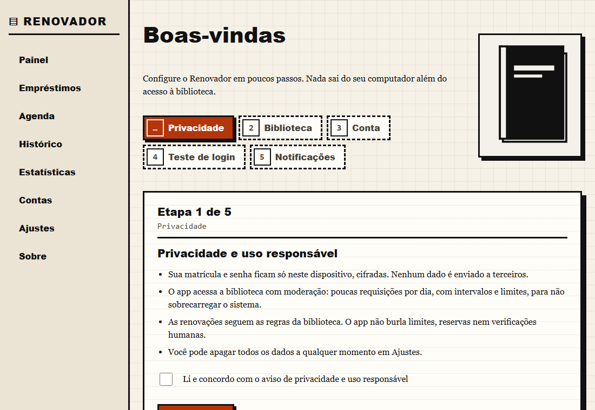

1. **Privacidade:** leia o resumo e marque "Li e concordo com o aviso de privacidade e uso responsável". Os textos completos estão em [aviso de privacidade](legal/aviso-de-privacidade.md) e [uso responsável](legal/uso-responsavel.md).
2. **Biblioteca:** a UFTM já vem selecionada. Outras bibliotecas que usam o Sophia podem ser informadas em "Avançado", mas são **experimentais**.
3. **Conta:** informe a matrícula (ou login) e a senha da biblioteca, as mesmas do site. Escolha o modo:
   - **Automático:** o app renova sozinho antes do vencimento;
   - **Manual:** o app só avisa; você decide quando renovar.
4. **Teste de login:** confere a matrícula e a senha com um acesso real à biblioteca. Esse teste conta na cota diária de acessos (seção 11). Você pode pular; o login será verificado na primeira sincronização.
5. **Notificações:** permita, para saber quando um livro for renovado ou quando algo falhar.

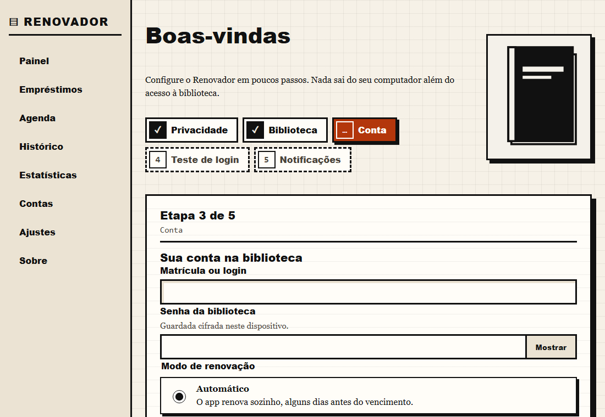

## 3. Painel

O painel mostra:
- os **próximos vencimentos**, do mais urgente para o menos urgente;
- o estado da **automação**: ligada, desligada ou pausada, com a última e a próxima renovação;
- o botão **Sincronizar agora**.

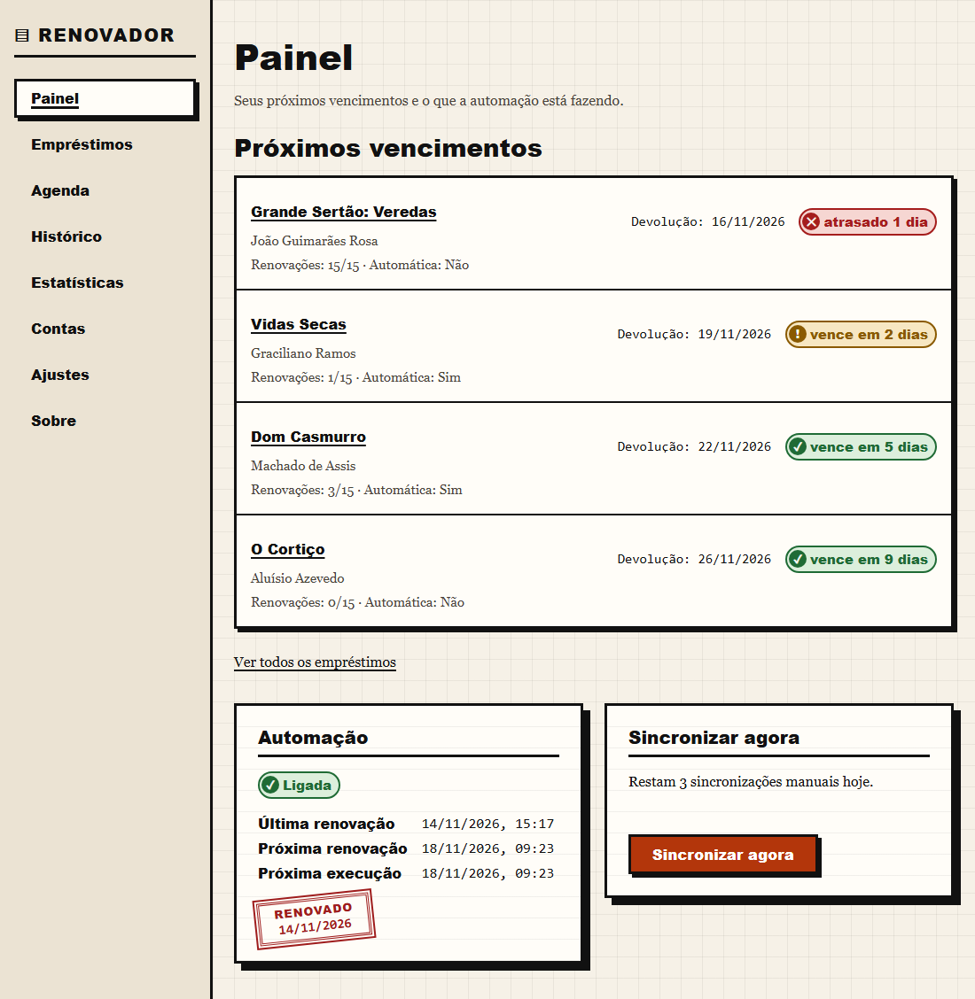

- Cada livro mostra a data de devolução e uma etiqueta: "vence hoje", "vence em N dias" ou "atrasado". A cor nunca é o único sinal: a etiqueta sempre tem texto e ícone.
- **Sincronizar agora** busca os empréstimos na biblioteca e renova o que estiver na janela de renovação. O progresso aparece passo a passo (entrar, listar, renovar, salvar). Há um limite de sincronizações manuais por dia; o painel mostra quantas restam.
- O carimbo "RENOVADO" indica a data da última renovação.

## 4. Empréstimos

A estante mostra cada empréstimo como uma lombada. Use a busca (título ou autor) e o filtro de situação (em dia, atrasado, devolvido).

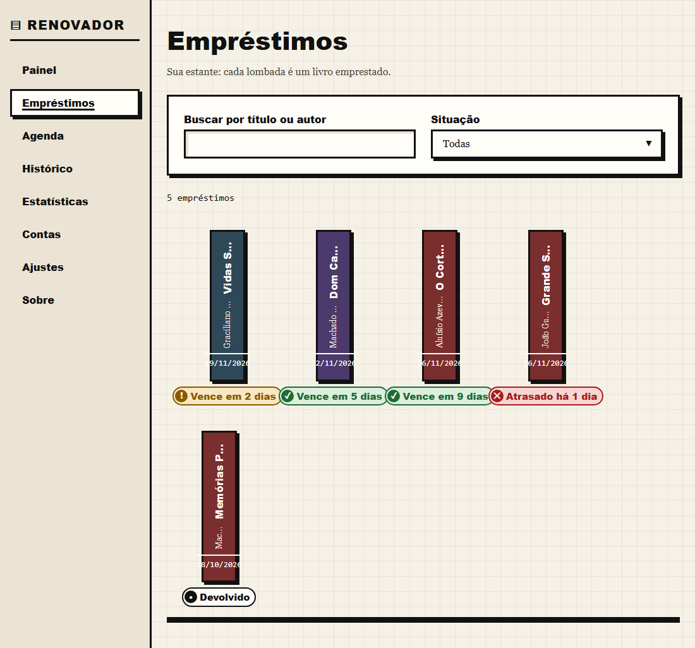

Clique num livro para abrir a ficha:

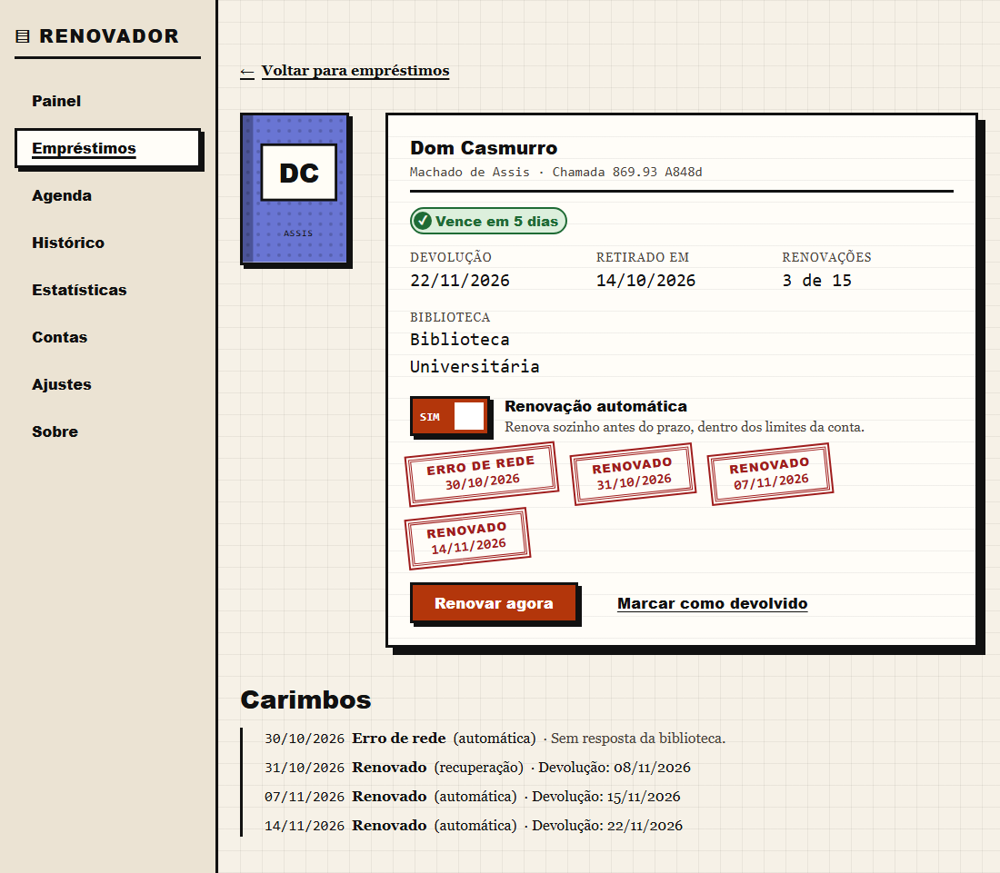

- **Renovação automática:** liga ou desliga a renovação só deste livro.
- **Renovar agora:** tenta renovar este livro imediatamente, mesmo longe do vencimento. Conta na cota de acessos como uma sincronização manual.
- **Marcar como devolvido:** tira o livro da estante e cancela as renovações dele. Use quando devolver antes da próxima sincronização.
- **Carimbos:** cada tentativa de renovação vira um carimbo, com o resultado e a nova data de devolução.

> **Importante:** se a biblioteca recusar a renovação porque o livro está **reservado**, atingiu o **limite de renovações**, a conta está **bloqueada** ou o livro está **em atraso**, o app desliga a renovação automática daquele livro, porque tentar de novo não adiantaria. Resolva a situação na biblioteca e religue a chave "Renovação automática" na ficha.

## 5. Agenda

A agenda lista o que o app planejou fazer: **renovações**, **sincronizações** (a cada 3 dias) e **lembretes**. Os horários são de Brasília.

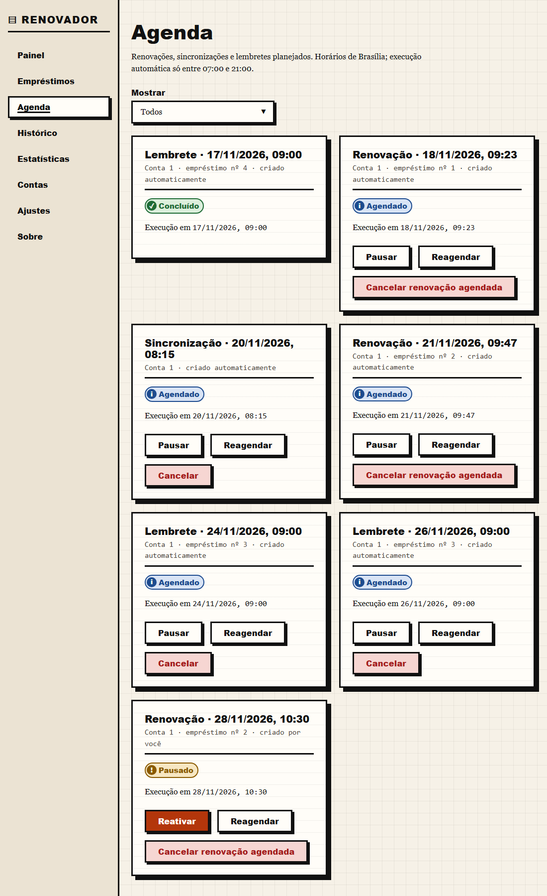

- **Pausar / Reativar:** suspende um agendamento sem apagá-lo.
- **Reagendar:** escolha outra data e hora, entre 07:00 e 20:59.
- **Cancelar:** o agendamento não será executado. Agendamentos que você cancelou não são recriados automaticamente, mas você pode reativá-los depois.

O minuto exato de cada renovação é sorteado dentro do período escolhido nos Ajustes, para não sobrecarregar a biblioteca.

## 6. Histórico e estatísticas

O **Histórico** guarda todas as tentativas de renovação, automáticas ou manuais, com o resultado e a mudança na data de devolução. É possível filtrar por conta, resultado e período, exportar em CSV ou JSON e apagar tentativas antigas.

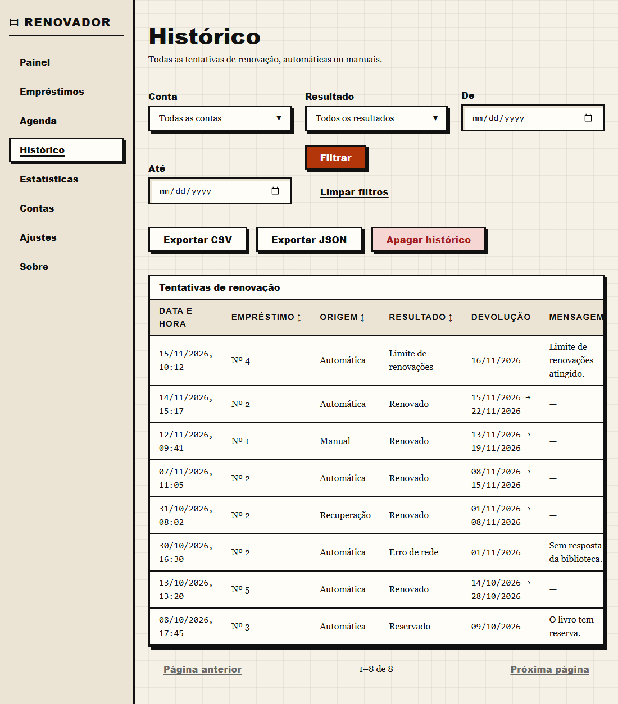

As **Estatísticas** resumem o período escolhido: livros distintos, empréstimos ativos, renovações feitas, taxa de sucesso, dias ganhos e o livro mais renovado. O gráfico mensal também está disponível como tabela, para leitores de tela.

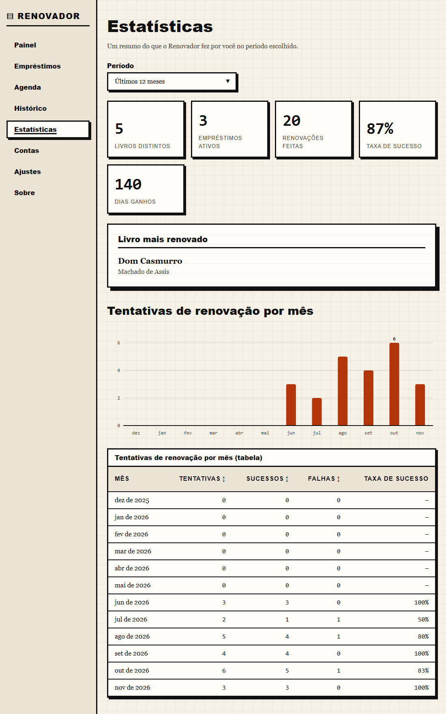

## 7. Contas

Você pode cadastrar até **3 contas** de biblioteca, por exemplo a sua e a de alguém da família, com a permissão dessa pessoa.

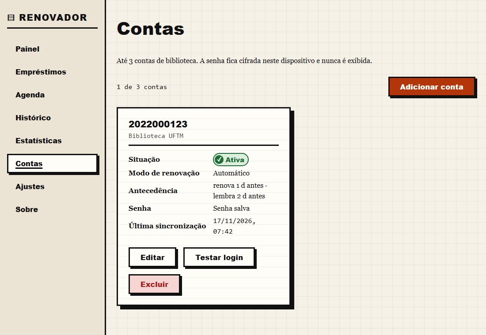

Em **Editar**, você pode:
- trocar a matrícula, a senha ou a biblioteca;
- **apagar a senha salva**: o app deixa de guardá-la, e a renovação automática para de funcionar nessa conta;
- escolher o **modo** (automático ou manual);
- definir a antecedência:
  - **Renovar:** de "no dia do vencimento" até 3 dias antes (padrão: 1 dia antes);
  - **Lembrete:** de "só no dia" até 7 dias antes (padrão: 2 dias antes). Vale para livros sem renovação automática ou cuja renovação falhou.

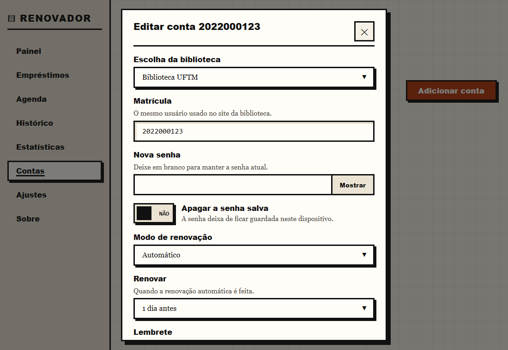

**Testar login** faz um acesso real à biblioteca e consome 1 sessão manual da cota. **Excluir** apaga deste dispositivo a senha, os empréstimos, a agenda e o histórico da conta. Não há como desfazer.

## 8. Ajustes

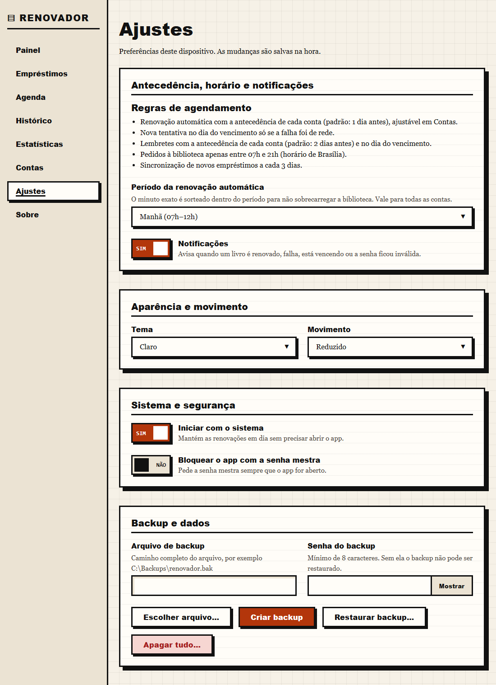

- **Período da renovação automática:** qualquer hora (07h–21h), manhã (07h–12h), tarde (12h–17h) ou noite (17h–21h). Vale para todas as contas.
- **Notificações:** liga ou desliga os avisos do app.
- **Tema:** seguir o sistema, claro, escuro ou alto contraste.
- **Movimento:** seguir o sistema, reduzido ou completo. "Reduzido" desliga animações.
- **Iniciar com o sistema** (computador): mantém as renovações em dia sem precisar abrir o app.
- **Bloquear o app com a senha mestra:** pede a senha mestra sempre que o app for aberto.
- **Backup:** cria uma cópia criptografada dos seus dados, protegida por uma senha de pelo menos 8 caracteres. Sem essa senha, o backup não pode ser restaurado. **Restaurar** substitui os dados atuais pelos do backup.
- **Apagar tudo:** apaga contas, senhas, empréstimos, agenda e histórico deste dispositivo. Para confirmar, digite APAGAR.

## 9. Notificações e segundo plano

O app avisa quando:
- um livro foi renovado (com a nova data);
- não foi possível renovar (com o motivo e a data limite de devolução);
- um livro está vencendo (conforme o lembrete da conta);
- um livro vence hoje e não foi renovado, porque o app só renova entre 07h e 21h;
- a senha da conta não foi aceita;
- a automação foi pausada.

**No computador**
- O app continua na **bandeja do sistema**, perto do relógio, quando você fecha a janela.
- O menu da bandeja tem **Abrir**, **Sincronizar agora**, **Pausar automação** e **Sair**.
- A pausa continua valendo depois de reiniciar o computador. Para retomar, desmarque "Pausar automação".
- Se o computador ficou desligado na hora de uma renovação, o app recupera ao ser aberto, desde que esteja dentro do horário permitido.

**No Android**
- O sistema executa as renovações em segundo plano, mesmo com o app fechado.
- Em economia de bateria ou sem internet, o Android pode atrasar a execução; ela acontece assim que possível.
- Se você negou as notificações, ative-as em **Configurações › Apps › Renovador de Livros › Notificações**.

## 10. Problemas comuns

| O que aparece | O que fazer |
|---|---|
| **Senha inválida** | Você trocou a senha no site da biblioteca? Atualize-a em Contas › Editar. |
| **A biblioteca pediu verificação humana** | A biblioteca ativou uma verificação (CAPTCHA). O app **não tenta contorná-la**: entre pelo site oficial, resolva a verificação e tente mais tarde. |
| **Cota de acessos esgotada** / "Disponível de novo às…" | O app limita os acessos por dia para não sobrecarregar a biblioteca. Espere o horário indicado. |
| **A biblioteca está instável; nova tentativa às…** | Várias falhas seguidas pausam os acessos por algumas horas. O app tenta de novo sozinho. |
| **Acesso à biblioteca desativado remotamente** | A automação foi desligada para todos os usuários (por exemplo, a pedido da biblioteca). Renove pelo site oficial. |
| **Automação pausada** | Veja o motivo no painel. Se você pausou pela bandeja, desmarque "Pausar automação". |
| **Livro com renovação automática desligada sozinha** | A biblioteca recusou (reserva, limite, bloqueio ou atraso). Veja a seção 4. |
| **Renovação fora do horário** | Renovações automáticas e reagendamentos só acontecem entre 07h e 21h (horário de Brasília). |

## 11. Privacidade e limites de uso

- **Seus dados ficam só neste dispositivo**, num banco criptografado. O projeto não tem servidor e não recebe nada seu.
- Guardar a senha é opcional. Sem senha salva, a renovação automática não funciona.
- No máximo uma vez por dia, o app baixa a política de segurança do projeto; nenhum dado seu é enviado.
- **Limites fixos de uso:**
  - uma requisição por vez, com intervalo de pelo menos 2 segundos;
  - no máximo 2 sessões automáticas e 4 manuais por conta por dia;
  - até 10 sessões por instalação por dia;
  - renovações automáticas só entre 07h e 21h.
- Esses limites não podem ser aumentados por configuração.
- O app se identifica honestamente para a biblioteca e segue as regras dela: não burla limites, reservas nem verificações humanas.
- Use apenas a sua conta, ou a de alguém que autorizou você.

A tela **Sobre** mostra:
- a versão instalada;
- esses textos de privacidade e uso responsável;
- as licenças de terceiros;
- um **diagnóstico** com as últimas requisições à biblioteca, sem senhas, útil para pedir ajuda.

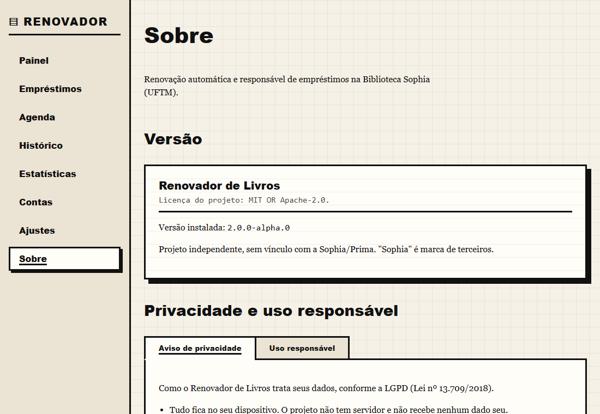

Projeto independente, sem vínculo com a Sophia/Prima. "Sophia" é marca de terceiros.
